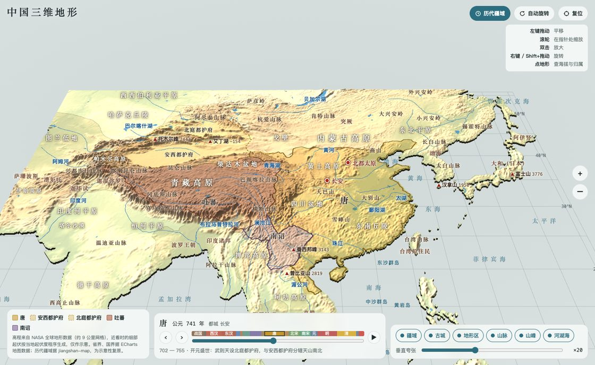
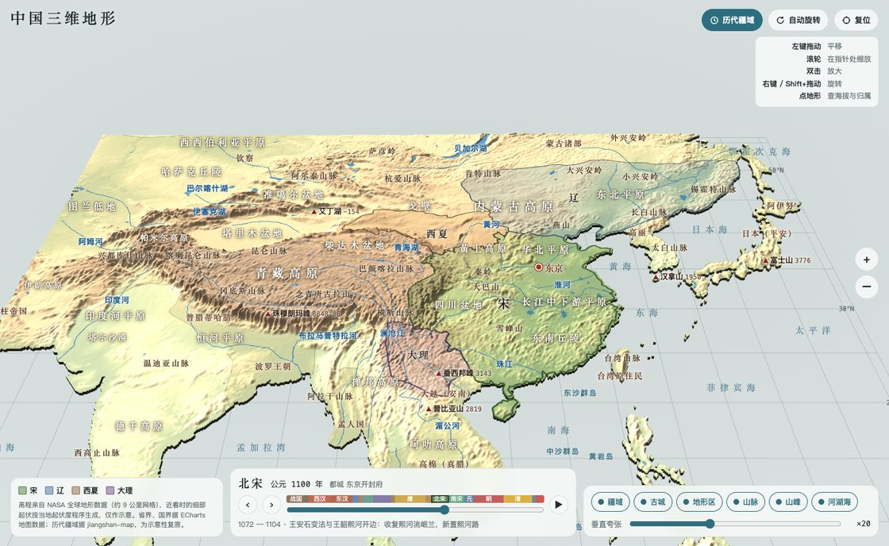
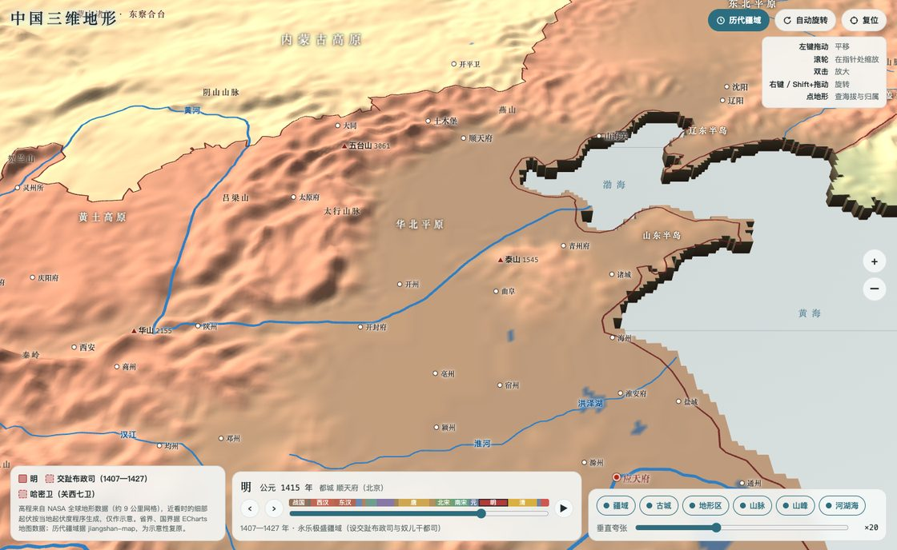
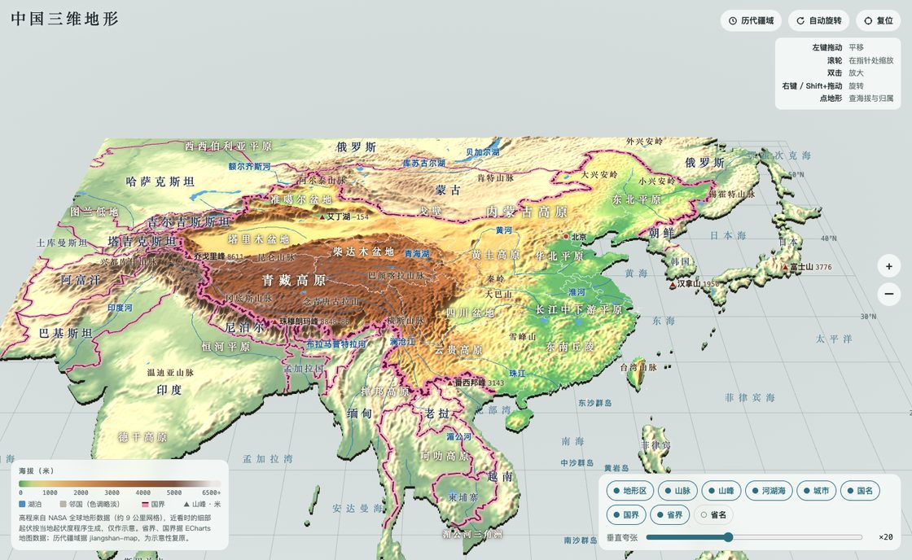
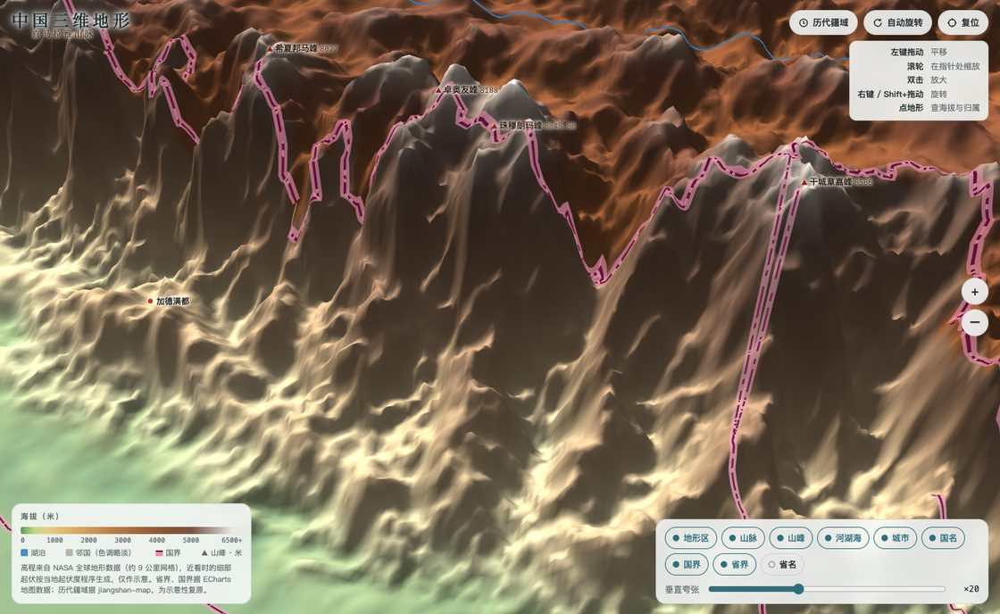
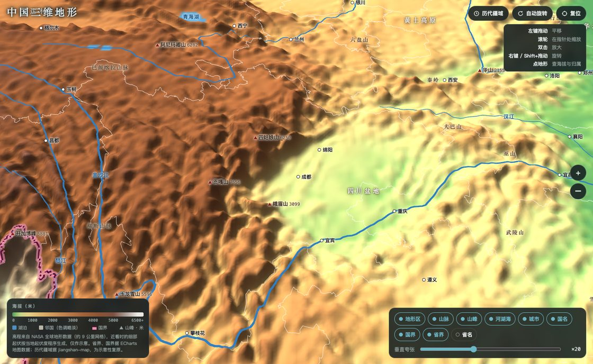
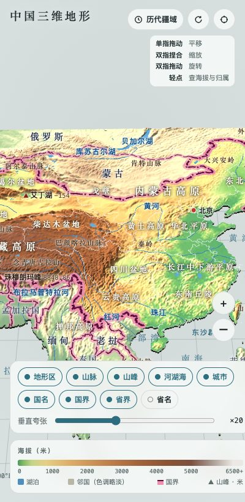

# 中国三维地形

可在浏览器里平移、缩放、旋转的中国及周边国家三维地形模型，并可沿时间轴查看从战国（前 403 年）到今天的历代疆域、都城和古城。整个页面是一个 `index.html` 文件，地形数据已内嵌在里面，可以直接打开，也可以用 GitHub Pages 托管。

**在线访问：<https://laskfla.github.io/china-terrain-3d/>**（电脑和手机浏览器均可，无需安装）

> 本项目受 [DeanChensj](https://github.com/DeanChensj) 的 [jiangshan-map（江山时序）](https://github.com/DeanChensj/jiangshan-map) 启发而做：那是一部可沿时间轴浏览的二维中国历史地图集。这里把它的历代疆域、都城与古城数据搬到了三维地形上。

也可以直接打开某一年，例如 [唐 · 741 年](https://laskfla.github.io/china-terrain-3d/?year=741)、[北宋 · 1100 年](https://laskfla.github.io/china-terrain-3d/?year=1100)；只看今日地形用 [`?mode=modern`](https://laskfla.github.io/china-terrain-3d/?mode=modern)。



| 北宋 · 1100 年 | 明 · 1415 年（华北近景） |
| --- | --- |
|  |  |

今日地形（`?mode=modern`）：



| 珠峰一带近景 | 四川盆地（深色模式） | 手机竖屏 |
| --- | --- | --- |
|  |  |  |

## 功能

- **历代疆域**（默认打开，右上角「历代疆域」按钮切换）
  - 时间轴覆盖战国至今 18 个时期、180 多个版图阶段：拖动滑块、点朝代色带跳到该朝，‹ › 逐阶段前后切换，▶ 自动播放。
  - 各政权的疆域着色并描边贴在地形上（主朝、对峙政权实线，都护府等羁縻地区虚线），标注政权名；左下角列出当前政权，点击可飞到该处。
  - 都城（红点）和当时的城市按年份显示，悬停或轻点可看古今地名与简介；悬停地面会显示所属政权和今属省份。
  - 1949 年以后显示今日省界与国界。地址栏的 `?year=` 会随时间轴更新，便于分享。
- **真实高程**：东经 60°–146°、北纬 3.5°–56°，0.1° 网格（约 9 公里），数据源自 NASA 全球地形图，经 40 多个已知海拔地点校准。
- **地图式操作**
  - 电脑：左键拖动平移，滚轮在指针处缩放，双击放大，右键或 Shift+拖动旋转，方向键平移。
  - 手机：单指平移，双指捏合缩放，双指拖动旋转。
- **近看加细节**：放大时，视野中心会生成约 1 公里的细分网格，海岸线和湖岸也会变得平滑。
- **标注**：地形区、山脉、山峰（含高度）、25 条河流、湖泊、海域、南海诸岛、省会和主要城市、邻国首都、国名。标注按缩放级别逐级出现，并自动避让重叠。
- **界线**：省界，以及国界（粉色底带加点划线，宽度按屏幕像素计算）。
- **其他**：可调垂直夸张倍数，点击或悬停查看所在省份/国家、经纬度和海拔；支持深色模式，手机竖屏可用。

## 直接使用

最简单的方式是打开在线页面 <https://laskfla.github.io/china-terrain-3d/>。也可以下载本仓库，双击 `index.html` 用浏览器打开。需要联网，因为 three.js 从 jsDelivr CDN 加载。

浏览器要求：Chrome / Edge 80+、Safari 16.4+、Firefox 113+（需要支持 WebGL 和 `DecompressionStream`）。

## 推送到 GitHub

```bash
cd china-terrain-3d
git init
git add .
git commit -m "中国三维地形"
git branch -M main
git remote add origin https://github.com/<你的用户名>/china-terrain-3d.git
git push -u origin main
```

如果要发布成网页：在仓库的 **Settings → Pages** 里，把 Source 设为从 `main` 分支的根目录部署。几分钟后就能通过 `https://<你的用户名>.github.io/china-terrain-3d/` 访问。

## 重新生成数据

一般不需要重新生成，`index.html` 已经是成品。只有修改了地形数据、河流或标注坐标时才需要。

依赖：Python 3.9+、Node.js 18+、git。

```bash
pip install -r requirements.txt
bash tools/fetch_sources.sh        # 下载源数据到 sources/（约 6 MB，git 稀疏克隆）
python3 tools/build_data.py        # 生成 build/terrain.json（高程、区域、起伏度、界线、河流）
node tools/build_history.js        # 生成 build/history.json（历代疆域、阶段、城市，取自 jiangshan-map）
python3 tools/build_page.py        # 把数据嵌入 src/template.html，输出 index.html
```

可选：离线截图检查。需要先 `npm i playwright && npx playwright install chromium`。

```bash
node tools/screenshot.js build/shots   # 输出全景、珠峰、四川盆地、手机，以及唐、北宋、明的截图（PNG）
```

构建结果是确定的：同样的输入，每次生成的 `index.html` 完全一样。

## 目录结构

```
index.html                  成品页面（数据已内嵌）
src/template.html           页面源码：界面、three.js 渲染、标注、交互
data/rivers.json            河流走向（手工数字化，构建时吸附到河谷）
tools/fetch_sources.sh      下载源数据
tools/extract_echarts_maps.js  从 ECharts 地图脚本中提取 GeoJSON
tools/build_data.py         生成地形数据包
tools/build_history.js      生成历代疆域数据包（简化到约 1 公里、去重、压缩）
tools/build_page.py         生成 index.html
tools/geo_util.py           ECharts 压缩坐标解码
tools/screenshot.js         无头浏览器截图
docs/                       README 用的截图
```

## 数据与精度说明

- **高程**：NASA 全球地形图（4096×2048，约 0.09°），按 `海拔 = 28.1 × (灰度 − 23.5)` 换算。在 44 个已知海拔的地点上，误差大多在 ±150 米以内。网格较粗，高峰会被平均掉，例如珠峰附近在模型中约 6500 米，标注里写的是真实高度。
- **近看细节**：比原始网格更细的起伏是按当地起伏度程序生成的，只是视觉示意，不是实测数据。
- **水体与海岸线**：来自 NASA 水体掩膜。
- **省界与国界**：来自 Apache ECharts 4.9 自带的中国地图和世界地图数据。中国国界取自中国地图的省级外轮廓；邻国之间的国界取自世界地图。
- **河流、地名坐标**：手工整理，属于近似位置。
- **历代疆域、都城与古城**：取自 [jiangshan-map](https://github.com/DeanChensj/jiangshan-map)（固定在提交 `b66b846`），为示意性复原，不是精确的历史边界。轮廓简化到约 1 公里精度；与本项目海岸线不吻合处，疆域着色会向外延伸约 10 公里补齐。

> 依据《地图管理条例》，在中国境内公开发布的地图需要送审并取得审图号。本项目仅供学习和演示，不应作为正式地图使用。

各数据来源及许可见 [NOTICE.md](NOTICE.md)。

## 致谢

感谢 [DeanChensj](https://github.com/DeanChensj) 的 [jiangshan-map（江山时序）](https://github.com/DeanChensj/jiangshan-map)。本项目的历史部分受它启发，历代疆域、朝代阶段、都城与古城数据也都来自它。想看更完整的历史地图功能（州郡政区、人物行迹、地名溯源等），请访问它的[在线版](https://deanchen.me/jiangshan-map/)。

## 许可

Copyright (C) 2026 sunaixu

项目采用 [GNU General Public License v3.0](LICENSE)（GPL-3.0）发布：可以自由使用、修改和再分发，但分发修改版时须同样以 GPL-3.0 开源并保留版权声明。历代疆域、都城等历史数据取自同样以 GPL-3.0 发布的 [jiangshan-map（江山时序）](https://github.com/DeanChensj/jiangshan-map)。其他第三方数据和库遵循各自的许可，见 [NOTICE.md](NOTICE.md)。
